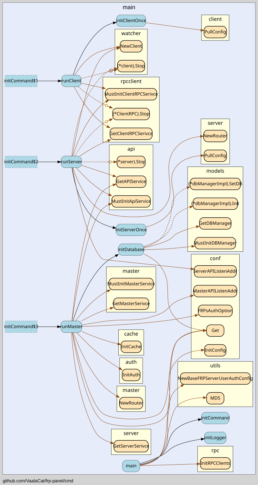

# 贡献指南

## 文档贡献指南

请fork本仓库，修改仓库目录下 `docs` 文件夹中的内容

## 项目开发指南

### 平台架构设计

技术栈选好了，下一步就是要设计程序的架构。在刚刚背景里说的那样，frp 本身有 frpc 和 frps（客户端和服务端），这两个角色肯定是必不可少了。然后我们还要新增一个东西去管理它们，所以 frp-panel 新增了一个 master 角色。master 会负责管理各种 frpc 和 frps，中心化的存储配置文件和连接信息。

然后是 frpc 和 frps。原版是需要在两边分别写配置文件的。那么既然原版已经支持了，就不用在走原版的路子，我们直接不支持配置文件，所有的配置都必须从 master 获取。

其次还要考虑到与原版的兼容问题，frp-panel 的客户端/服务端都必须要能连上官方 frpc/frps 服务。这样的话就可以做到配置文件/不要配置文件都能完美工作了。
总的说来架构还是很简单的。


### 开发

项目包含三个角色

1. Master: 控制节点，接受来自前端的请求并负责管理 Client 和 Server
2. Server: 服务端，受控制节点控制，负责对客户端提供服务，包含 frps 和 rpc(用于连接 Master)服务
3. Client: 客户端，受控制节点控制，包含 frpc 和 rpc(用于连接 Master)服务

接下来给出一个项目中各个包的功能

```
.
|-- biz                 # 主要业务逻辑
|   |-- client          # 客户端逻辑（这里指的是frp-panel的客户端）
|   |-- master          # frp-panel 控制平面，负责处理前端请求，并且使用rpc管理frp-panel的server和client
|   |   |-- auth        # 认证模块，包含用户认证和客户端认证
|   |   |-- client      # 客户端模块，包含前端管理客户端的各种API
|   |   |-- server      # 服务端模块，包含前端管理服务端的各种API
|   |   `-- user        # 用户模块，包含用户管理、用户信息获取等
|   `-- server          # 服务端逻辑（这里指的是frp-panel的服务端）
|-- cache               # 缓存，用于存储frps的认证token
|-- cmd                 # 命令行入口，main函数的所在地，负责按需启动各个模块
|-- common
|-- conf
|-- dao                 # data access object，任何和数据库相关的操作会调用这个库
|-- doc                 # 文档
|-- idl                 # idl定义
|-- middleware          # api的中间件，包含JWT和context相关，用于处理api请求，鉴权通过后会把用户信息注入到context，可以通过common包获取
|-- models              # 数据库模型，用于定义数据库表。同时包含实体定义
|-- pb                  # protobuf生成的pb文件
|-- rpc                 # 各种rpc的所在地，包含Client/Server调用Master的逻辑，也包含Master使用Stream调用Client和Server的逻辑
|-- services            # 各种需要在内存中持久运行的模块，这个包可以管理各个服务的运行/停止
|   |-- api             # api服务，运行需要外部传入一个ginRouter
|   |-- client          # frp的客户端，即frpc，可以控制frpc的各种配置/开始与停止
|   |-- master          # master服务，包含rpc的服务端定义，接收到rpc请求后会调用biz包处理逻辑
|   |-- rpcclient       # 有状态的rpc客户端，因为rpc的client都没有公网ip，因此在rpc client启动时会调用master的stream长连接rpc，建立连接后Master和Client通过这个包通信
|   `-- server          # frp的服务端，即frps，可以控制frps的各种配置/开始与停止
|-- tunnel              # tunnel模块，用于管理tunnel，也就是管理frpc和frps服务
|-- utils
|-- watcher             # 定时运行的任务，比如每30秒更新一次配置文件
`-- www
    |-- api
    |-- components # 这里面有一个apitest组件用于测试
    |   `-- ui
    |-- lib
    |   `-- pb
    |-- pages
    |-- public
    |-- store
    |-- styles
    `-- types

```

### 调试启动方式：

- master: `go run cmd/*.go master`
  > client 和 server 的具体参数请复制 master webui 中的内容
- client: `go run cmd/*.go client -i <clientID> -s <clientSecret>`
- server: `go run cmd/*.go server -i <serverID> -s <serverSecret>`

项目配置文件会默认读取当前文件夹下的.env 文件，项目内置了样例配置文件，可以按照自己的需求进行修改

详细架构调用图



### 数据库 schema 迁移

表结构由两部分机制共同演进（见 `models/db.go` 的 `Init()`）：

1. **AutoMigrate**：启动时对 `models/` 中注册的全部模型补齐新列/新表/新索引（只增，不改不删）；
2. **版本化迁移**：AutoMigrate 之后执行 `models/migrate.go` 中注册的迁移步骤，负责 AutoMigrate 表达不了的操作——破坏性变更（删索引/删列/改类型）与数据回填。

已应用的迁移记录在 `schema_migrations` 表（`models.MigrationRecord`），启动时按版本号跳过已应用项；每个步骤与版本记录在同一事务内原子提交。

**新增迁移**：在 `models/migrate.go` 的 `migrationSteps` 切片尾部追加一条，`version` 取上一条 +1，`name` 用小写下划线命名，例如：

```go
{version: 2, name: "backfill_proxy_config_tenant", up: backfillProxyConfigTenant},
```

编写迁移的三条规则：

- **可重复执行**：失败重跑或部分提交后重跑不得产生二次破坏（MySQL 的 DDL 是隐式提交、无法整体回滚，尤其需要保证）；
- **方言可移植**：优先使用 GORM Migrator API（`HasIndex`/`DropIndex`/`RenameColumn`/`HasColumn` 等）保证 sqlite/mysql/postgres 三种方言一致；确需方言分支时按 `db.Dialector.Name()` 区分；
- **依赖列先存在**：迁移在 AutoMigrate 之后执行，回填类迁移可以直接使用模型新加的列；模型对应的表仍由 AutoMigrate 建表与加列，迁移不要重复建。

迁移状态可通过 `frpp check` 的 `data/db_migration` 检查项对账（见 [checker.md](/checker.md)）。

### 本体配置说明

[settings.go](https://github.com/fengmuxi/frp-panel/blob/main/conf/settings.go)
这里有详细的配置参数解释，需要进一步修改配置请参考该文件
