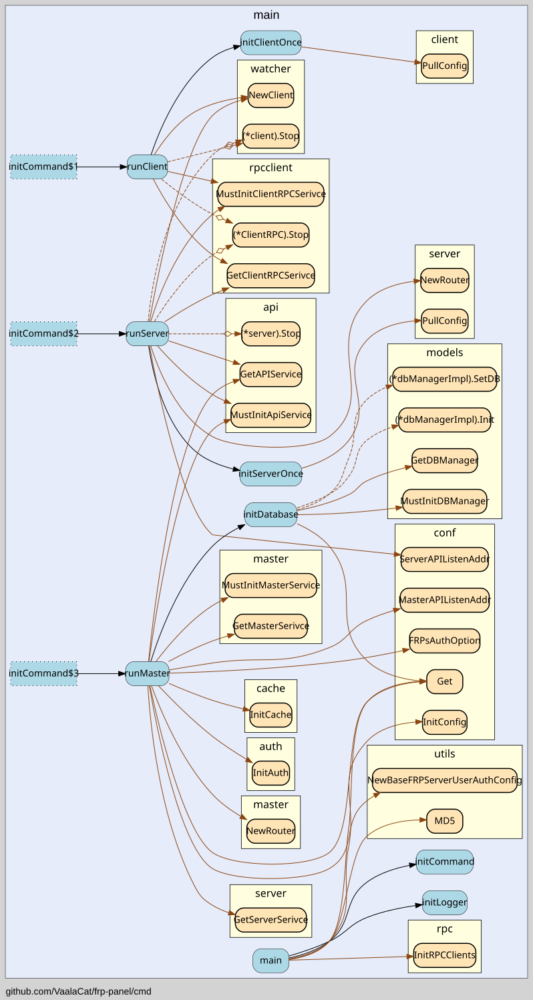

## Project Development Guide

### Platform Architecture Design

After choosing the tech stack, the next step is to design the program architecture. As mentioned in the background, frp itself has frpc and frps (client and server), these two roles are indispensable. Then we need to add something new to manage them, so frp-panel introduces a new master role. The master will be responsible for managing various frpc and frps, as well as centrally storing configuration files and connection information.

Next, we have frpc and frps. The original version requires writing configuration files on both sides. Since the original version already supports this, we don't need to follow the original approach. We will directly not support configuration files, and all configurations must be obtained from the master.

In addition, we also need to consider the compatibility with the original version. The client/server of frp-panel must be able to connect to the official frpc/frps service. In this way, both configuration file and non-configuration file modes can work perfectly.
Overall, the architecture is quite simple.


### Development

The project includes three roles:

1. Master: The control node, accepts requests from the frontend and is responsible for managing Client and Server.
2. Server: The server side, controlled by the control node, responsible for providing services to clients, including frps and rpc (for connecting to the Master) services.
3. Client: The client side, controlled by the control node, including frpc and rpc (for connecting to the Master) services.

Next, we will provide the functionality of each package in the project:

```
.
|-- biz                 # Main business logic
|   |-- client          # Client logic (here referring to the frp-panel client)
|   |-- master          # frp-panel control plane, responsible for handling frontend requests, and using rpc to manage frp-panel's server and client
|   |   |-- auth        # Authentication module, including user authentication and client authentication
|   |   |-- client      # Client module, including various APIs for the frontend to manage clients
|   |   |-- server      # Server module, including various APIs for the frontend to manage servers
|   |   `-- user        # User module, including user management, user information retrieval, etc.
|   `-- server          # Server logic
|-- cache               # Cache, used to store frps authentication tokens
|-- cmd                 # Command line entry, where the main function is located, responsible for starting various modules as needed
|-- common
|-- conf
|-- dao                 # Data access object, any operations related to the database will call this library
|-- doc                 # Documentation
|-- idl                 # IDL definitions
|-- middleware          # API middleware, including JWT and context-related, used to process API requests. After authentication passes, user information will be injected into the context and can be obtained through the common package.
|-- models              # Database models, used to define database tables. Also includes entity definitions.
|-- pb                  # Generated protobuf pb files
|-- rpc                 # Location of various rpcs, including the logic for Client/Server to call Master, as well as the logic for Master to use Stream to call Client and Server
|-- services            # Various modules that need to run persistently in memory, this package can manage the running/stopping of various services
|   |-- api             # API service, requires an external ginRouter to run
|   |-- client          # frp client, i.e., frpc, can control various configurations/start and stop of frpc
|   |-- master          # Master service, including the rpc server definition, after receiving an rpc request, it will call the biz package to handle the logic
|   |-- rpcclient       # Stateful rpc client, because the rpc clients don't have public IP addresses, the rpcclient will call the master's stream long-connection rpc when starting, and after the connection is established, the Master and Client communicate through this package
|   `-- server          # frp server, i.e., frps, can control various configurations/start and stop of frps
|-- tunnel              # Tunnel module, used to manage tunnels, i.e., manage frpc and frps services
|-- utils
|-- watcher             # Scheduled tasks, e.g., updating configuration files every 30 seconds
`-- www
    |-- api
    |-- components      # There is an apitest component here for testing
    |   `-- ui
    |-- lib
    |   `-- pb
    |-- pages
    |-- public
    |-- store
    |-- styles
    `-- types
```

### Debugging and Startup Methods:

- master: `go run cmd/*.go master`
  > For client and server, please copy the content from the master webui
- client: `go run cmd/*.go client -i <clientID> -s <clientSecret>`
- server: `go run cmd/*.go server -i <serverID> -s <serverSecret>`

The project configuration file will read the .env file in the current folder by default. The project includes a sample configuration file, which can be modified according to your needs.

Detailed architecture call diagram:



### Database Schema Migrations

The table schema evolves through two mechanisms (see `Init()` in `models/db.go`):

1. **AutoMigrate**: on startup, adds new columns/tables/indexes for all models registered in `models/` (additive only — no changes or drops);
2. **Versioned migrations**: executed after AutoMigrate, the steps registered in `models/migrate.go` handle what AutoMigrate cannot express — destructive changes (dropping indexes/columns, changing types) and data backfills.

Applied migrations are recorded in the `schema_migrations` table (`models.MigrationRecord`); already-applied versions are skipped on startup, and each step commits atomically in the same transaction as its version record.

**Adding a migration**: append one entry to the `migrationSteps` slice in `models/migrate.go`, with `version` set to the previous entry + 1 and a lowercase underscore-separated `name`, for example:

```go
{version: 2, name: "backfill_proxy_config_tenant", up: backfillProxyConfigTenant},
```

Three rules for writing a migration:

- **Repeatable**: re-running after a failure or partial commit must not cause double damage (MySQL DDL commits implicitly and cannot be rolled back as a whole, so this matters even more there);
- **Dialect-portable**: prefer the GORM Migrator API (`HasIndex`/`DropIndex`/`RenameColumn`/`HasColumn`, etc.) so sqlite/mysql/postgres behave the same; when a dialect branch is unavoidable, branch on `db.Dialector.Name()`;
- **Columns exist first**: migrations run after AutoMigrate, so backfill migrations may use newly added model columns directly; model-owned tables are still created and extended by AutoMigrate — do not duplicate that in migrations.

Migration status can be reconciled with the `data/db_migration` checker of `frpp check` (see [checker.md](/checker.md)).

### Core Configuration Explanation

[settings.go](https://github.com/fengmuxi/frp-panel/blob/main/conf/settings.go)
This file contains detailed explanations of the configuration parameters. Please refer to this file if you need to further modify the configuration.
